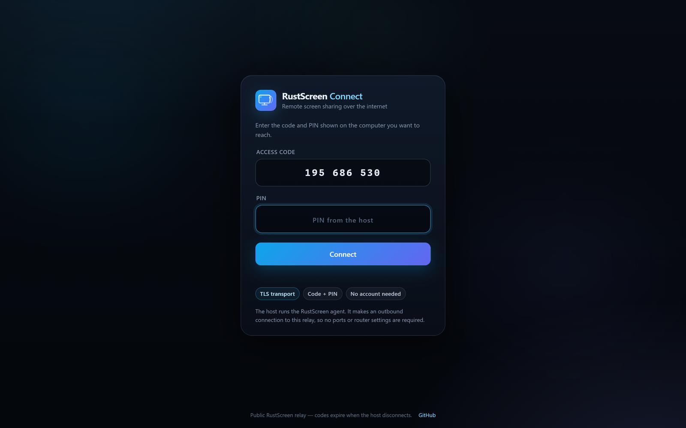
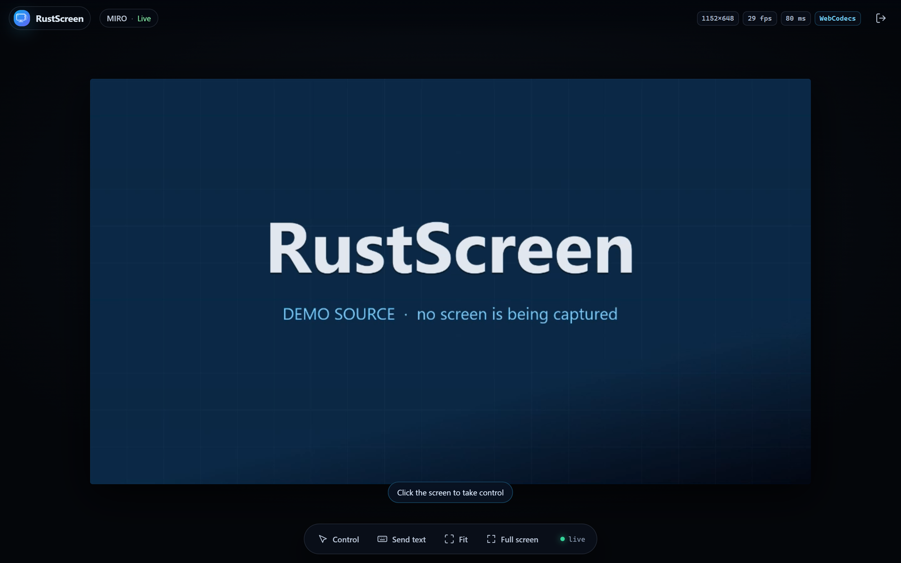

# RustScreen

[](https://github.com/miro187/rustscreen/actions/workflows/ci.yml)
[](https://github.com/miro187/rustscreen/releases)
[](LICENSE)

**Self-hosted screen sharing and remote control — on your LAN or over the internet.**
A RustDesk-style remote desktop written in Rust. **LAN mode** is a single binary with an embedded browser client. **Public mode** pairs a small relay with outbound agents: viewers enter a 9-digit code and a PIN, no port forwarding required.


<p align="center">
  
  
</p>

<p align="center">
  
  
</p>

---

## Features

- **Public access with codes** — a relay + agent mode lets you reach PCs anywhere with a 9-digit code and PIN. Agents connect **outbound**, so NAT/CGNAT and port forwarding are not an issue. Works behind a Cloudflare Tunnel or any reverse proxy.
- **Browser-first viewers** — Windows, macOS, Linux, Android and modern iPadOS/iOS: any recent Chrome/Edge, Firefox or Safari works. No client install. The public relay viewer currently uses WebCodecs (Chrome/Edge).
- **Low-latency H.264** — Chrome/Edge use **WebCodecs** (canvas rendering, ~1 frame latency). Firefox/Safari fall back to **fragmented MP4 + Media Source Extensions** automatically.
- **Real remote control** — mouse, wheel, multi-monitor coordinates, full keyboard mapping, Unicode/clipboard text injection.
- **Display & window sources** — pick a monitor, a window, all displays, or a privacy-safe demo pattern, with live thumbnails.
- **Quality control** — FPS, bitrate, scale, and encoder (NVENC / Quick Sync / AMF / Media Foundation / x264) can be changed on the fly.
- **Private by default** — random 6-digit PIN, HTTP-only session cookies, login rate limiting, SameSite/CSRF protection, WebSocket origin checks, CSP, and a self-signed TLS certificate generated on first run.
- **Control modes** — all viewers, one controller at a time, or view-only.
- **Optional audio** — stream system audio or a microphone via DirectShow (needs a loopback device for system sound).
- **Two small binaries** — `rustscreen` (host/agent) and `rustscreen-relay`; only `ffmpeg` is required at runtime.
- **No telemetry, no accounts, no vendor cloud.** LAN mode is fully offline; the public relay is optional and self-hosted.

Under the hood: [axum](https://github.com/tokio-rs/axum) + [tokio](https://tokio.rs), ffmpeg for capture/encode, [enigo](https://github.com/enigo-rs/enigo) for input injection, and a small H.264/fMP4 parser that fans the encoded stream out to browsers.

## Quick start

### 1. Get ffmpeg

RustScreen uses ffmpeg for screen capture and hardware encoding.

| Platform | Command |
|---|---|
| Windows | `winget install Gyan.FFmpeg` |
| macOS | `brew install ffmpeg` |
| Debian/Ubuntu | `sudo apt install ffmpeg` |

Verify with `ffmpeg -version`.

### 2. Run RustScreen

Download the latest `rustscreen-*-windows-x86_64.zip` from [Releases](https://github.com/miro187/rustscreen/releases), or build from source (see below), then:

```powershell
.\rustscreen.exe
```

The terminal prints the connection URLs, a PIN, and a QR code:

```
  RustScreen
  ──────────────────────────────────────────────────────────
  Host           MY-PC (Windows)
  Local          https://127.0.0.1:8443
  Ethernet       https://192.168.1.42:8443
  PIN            4 8 2 9 1 3
  Control        enabled for all viewers
  Source         Primary display (1920x1080)
  Stream         1920x1080 @ 30 fps, 6000 kb/s, h264_mf
  TLS            self-signed certificate (accept the browser warning once)
  ──────────────────────────────────────────────────────────
```

Open the network URL on any device on the same Wi-Fi/LAN, accept the self-signed certificate warning once, and enter the PIN.

> **Firewall:** Windows may ask for permission the first time. Allow RustScreen on **private networks**. It only listens on the port you choose (default `8443`).

### Run without touching your real screen

```bash
rustscreen --source demo
```

The demo source is generated by ffmpeg and shows a branded gradient — useful for testing a connection, recording a demo, or trying the controls without exposing your desktop.

## Public access (code + PIN)

The relay is a small Rust binary that pairs an **outbound agent** on a PC with a **browser viewer**. Each agent gets a 9-digit code and a PIN from its own terminal. The relay serves the viewer UI, or you can host that UI elsewhere.

### 1. Start the relay

Run it on a VPS, or on a machine behind a Cloudflare Tunnel / reverse proxy:

```powershell
.
ustscreen-relay.exe --bind 127.0.0.1 --port 8090 --token "<LONG-RANDOM-TOKEN>"
```

For a quick public URL without a domain or port forwarding:

```powershell
cloudflared tunnel --url http://127.0.0.1:8090 --no-autoupdate
# prints: https://<random>.trycloudflare.com
```

> Quick Tunnels are temporary and get a new URL on restart. For a permanent deployment use a **named Cloudflare Tunnel + domain** or put Caddy/nginx in front of the relay on a VPS.

### 2. Start an agent on every PC you want to reach

Download `rustscreen.exe` and `ffmpeg`, then:

```powershell
.
ustscreen.exe `
  --relay https://<random>.trycloudflare.com `
  --relay-token "<LONG-RANDOM-TOKEN>" `
  --password "<YOUR-PIN>" `
  --source primary
```

The agent prints a **viewer URL, 9-digit code, and PIN** and connects outbound. Repeat on as many PCs as you like — each one gets its own code.

### 3. Connect from anywhere

Open the relay URL on any device, enter the **code + PIN**. Browsers with WebCodecs (Chrome/Edge) get the low-latency stream.

- `--source demo` is handy for testing without exposing a real desktop.
- `--control none` makes a host view-only; `--control single` allows one controller (the relay already allows one viewer per code).
- Codes stay valid as long as the agent is connected; they change if the agent or relay restarts.

The relay's viewer UI is embedded in the relay binary, so Vercel is not required. You can still deploy `relay-web/` to Vercel and point it at the relay with `?relay=https://<relay-url>` if you prefer a separate frontend.

## Build from source

Requirements: **Rust 1.85+**, **ffmpeg**, and on Windows the **MSVC C++ build tools**.

```bash
git clone https://github.com/miro187/rustscreen.git
cd rustscreen
cargo build --release
# binaries: target/release/rustscreen(.exe) and target/release/rustscreen-relay(.exe)
```

Linux build dependencies (needed by the display/window enumeration crate):

```bash
sudo apt install pkg-config libclang-dev libxcb1-dev libxrandr-dev \
                 libdbus-1-dev libpipewire-0.3-dev libwayland-dev libegl-dev
```

> **Git Bash on Windows:** Git's `/usr/bin/link` shadows MSVC's `link.exe`. Build from PowerShell/CMD, or run `cargo` with the MSVC environment (`cmd /c "vcvars64.bat && cargo build --release"`).

Platform support:

| Host | Status |
|---|---|
| Windows 10/11 | Primary target — fully tested (GDI capture, DirectShow audio, input injection) |
| Linux X11 | Capture/enumeration implemented, expected to work; less tested |
| macOS | Capture implemented (AVFoundation); needs Screen Recording permission; less tested |
| Wayland | Not supported for capture (no portal implementation yet) |

## Usage

```text
rustscreen [OPTIONS]

  -p, --port <PORT>            Port to listen on [default: 8443]
      --bind <ADDR>            Address to bind [default: 0.0.0.0]
      --password <PASSWORD>    PIN/password; "none" disables auth; default random 6-digit PIN
      --control <MODE>         all | single | none [default: all]
      --source <SOURCE>        primary | all | monitor:<id> | window:<id> | demo [default: primary]
      --fps <FPS>              Capture FPS, 5-60 [default: 30]
      --bitrate <KBPS>         Bitrate in kb/s [default: 6000]
      --scale <FACTOR>         Output scale, 0.25-1.0 [default: 1.0]
      --encoder <ENC>          auto | nvenc | qsv | amf | mf | x264 [default: auto]
      --no-tls                 Serve plain HTTP (traffic is NOT encrypted)
      --cert <FILE> --key <FILE>  Use a custom TLS certificate
      --ffmpeg <FILE>          Path to the ffmpeg executable
      --audio [DEVICE]         Stream audio (a DirectShow device, or "auto")
      --max-viewers <N>        Simultaneous viewers, 1-64 [default: 8]
      --no-qr                  Don't print a QR code
      --open                   Open the local URL in a browser
      --relay <URL>            Agent mode: connect outbound to a relay (no local server)
      --relay-token <TOKEN>    Shared relay secret (or RUSTSCREEN_RELAY_TOKEN)
      --list-sources           List capturable displays/windows and exit
      --list-encoders          Probe H.264 encoders and exit
  -h, --help / -V, --version
```

Examples:

```bash
# Let a coworker control your second display, one controller at a time
rustscreen --source monitor:131073 --control single

# 1080p60, fixed password, plain HTTP on a trusted wired LAN
rustscreen --no-tls --password "my-secret" --fps 60 --bitrate 12000

# Stream system audio (install "Stereo Mix"/VB-Cable for loopback on Windows)
rustscreen --audio "Stereo Mix (Realtek(R) Audio)"

# Show what ffmpeg can use on this machine
rustscreen --list-encoders
```

### Changing sources and quality while running

**LAN mode:** open **Settings** in the viewer. The host stream is shared; changes apply to every viewer and briefly restart the encoder. Viewers reconnect automatically. **Relay mode** has no settings drawer — choose `--source`, `--fps`, `--bitrate`, `--scale` when starting the agent.

### Keyboard & clipboard

- Once you take control, keystrokes go to the host. A few **browser-reserved shortcuts can never be forwarded** (e.g. `Ctrl+W`, `Ctrl+T`, `Ctrl+N`).
- `Ctrl+V` (while controlling) reads your local clipboard and types the text on the host. The **Send text** dialog is the reliable fallback on phones and for Unicode/IME input.
- `Ctrl+Alt+Del` cannot be injected by a normal desktop app; use the host directly.
- On phones, drag to move the pointer and tap to click; the LAN viewer also supports two-finger scrolling. Use **Send text** for typing.

## How it works

```
             ┌────────────────────────── host: rustscreen ──────────────────────────┐
             │                                                                      │
 browser ────┼─ HTTPS  /            embedded web client                              │
 (viewer)    │        /api/stream   fragmented MP4  ──┐                              │
             │        /api/ws       Annex-B H.264  ──┤── broadcast hub ◄── ffmpeg    │
             │        /api/control  pointer/key WS   │        (fragment parser)  ▲   │
             │        /api/settings quality/source   │                          │   │
             │                                       ▼                          │   │
             │                                   axum server ─── spawn ─── gdigrab / x11grab / avfoundation
             │                                                               H.264 (NVENC/QSV/AMF/MF/x264)
             └──────────────────────────────────────────────────────────────────────┘
```

Public/relay mode:

```
 browser (relay UI) ──WSS──► rustscreen-relay ◄──WSS── rustscreen --relay (agent on a PC)
                                 │  9-digit code + PIN, rate limits, one viewer
                                 └── forwards H.264 frames + input events
```

- In relay mode the agent encodes locally and connects **outbound** to the relay; the relay only pairs and forwards. Cloudflare Tunnel (or Caddy/nginx/a VPS) terminates TLS.
- **Video is encoded once** and fanned out to all viewers.
- Two transports are available simultaneously:
  - `GET /api/ws` → raw Annex-B access units, decoded by WebCodecs and painted to a canvas (lowest latency).
  - `GET /api/stream` → fragmented MP4 boxes appended to a MediaSource (broad compatibility).
- New viewers receive the cached init segment plus the latest keyframe, so playback starts immediately (GOP = 1 second).
- Input is sent over a separate WebSocket; mouse coordinates are normalized to the captured rectangle, so multi-monitor and DPI-scaled desktops map correctly.
- The host process is placed in a Windows **job object with kill-on-close**, so capture processes cannot outlive a crashed server.

## Security

Read [SECURITY.md](SECURITY.md). **LAN mode** is designed for trusted networks; **relay mode** is internet-facing by design.

- HTTPS with a self-signed certificate is the default; a certificate is generated once and stored in `%APPDATA%\rustscreen\tls` (`~/.config/rustscreen/tls` on Linux).
- The PIN is required for every new session. Failed logins are rate-limited per IP (8/min). Sessions are HTTP-only, SameSite=Strict cookies; WebSockets additionally validate the `Origin` header.
- `--control none` makes a session view-only; `--control single` grants an exclusive control lease.
- The web client enforces a strict CSP and never loads third-party resources.
- Traffic is encrypted with TLS, but the certificate is self-signed. For LAN use this is usually acceptable; use `--cert/--key` for a proper certificate or `--no-tls` only on a trusted wired network.

**Relay mode** is internet-facing by design:

- TLS terminates at Cloudflare (or your reverse proxy); the relay itself speaks HTTP on localhost/tailnet. Cloudflare can see the PIN and the video. **There is no end-to-end encryption yet** — run your own relay if that matters.
- Agents must present the relay **token**. Keep it secret; anyone with the token can register an agent, but still cannot view a PC without its code + PIN.
- Viewer auth is **9-digit code + PIN**. PIN failures are rate-limited per IP (12/min) at the relay; use a strong `--password` rather than the default 6-digit PIN for anything long-lived.
- Only **one viewer per code** is allowed in the current relay. Codes exist only while the agent is connected and expire on relay/agent restart.
- The relay does not persist anything, but it is a public endpoint: use a firewall, keep it updated, and prefer `--control none` for view-only use. Use a named Cloudflare Tunnel/domain and a VPS for permanent deployments; Quick Tunnels are temporary.
- Do not expose `rustscreen.exe` (the LAN server) directly to the internet. Public access goes through the relay.

## Troubleshooting

| Problem | Fix |
|---|---|
| Browser says the certificate is not private | Expected with the generated self-signed certificate. Choose *Advanced → Proceed*, or install the certificate from `/api/cert`. |
| "ffmpeg is required" on start | Install ffmpeg and make sure `ffmpeg -version` works, or pass `--ffmpeg <path>`. |
| Black or frozen screen | Some DRM/protected windows cannot be captured. UAC secure desktop and lock screen are also excluded. Try `--encoder libx264`. |
| Mouse is offset on a scaled display | Make sure all displays use the same DPI scale (Windows GDI limitation). The app remaps coordinates for the common case automatically. |
| No system audio | Windows needs a loopback device. Enable **Stereo Mix** in Sound settings or install VB-Cable, then `--audio auto` or pass the device name. |
| Linux build fails | Install the X11/PipeWire development packages listed above. Wayland capture is not supported yet. |
| macOS capture is black | Grant Screen Recording permission to the terminal/binary in *System Settings → Privacy & Security*. |
| Viewer limit reached | Increase `--max-viewers` (default 8). |
| iPhone/iPad shows a blank player | Very old iOS versions cannot play H.264 in a MediaSource. Use a recent Safari (iOS/iPadOS 17+) or an Android device with Chrome. |
| Window capture shows the wrong area | A window source captures the visible screen rectangle chosen when the stream starts. Re-apply the source after moving or resizing the window. |
| Relay says "No computer is online with that code" | The agent is stopped, reconnecting, or has a new code after a restart. Check the agent terminal. |
| "Someone is already connected to this computer" | The relay allows one viewer per code. Close the other viewer tab. |
| Public viewer stays black / codec error | The relay viewer currently requires WebCodecs. Use recent Chrome/Edge, or use the LAN viewer for MSE/Safari. |
| Cloudflare URL stopped working | Quick Tunnel URLs change when cloudflared restarts. Copy the new URL into the agent's `--relay` argument. |
| Agent cannot connect to the relay | Check `--relay-token`, the tunnel URL, and that cloudflared/relay are running. Agents connect outbound to `wss://.../agent`. |

Logging: set `RUST_LOG=debug` (or `rustscreen=debug`) for detailed logs. `RUST_LOG=rustscreen=trace` logs every input event.

## Development

```bash
cargo fmt --check
cargo clippy --all-targets -- -D warnings
cargo test
cargo run -- --source demo --no-qr      # run locally without capturing your screen
```

The UI is hand-written HTML/CSS/JS in `assets/` (LAN) and `relay-web/` (public relay), embedded with `include_str!` — no Node build step. End-to-end flows (WebCodecs, MSE, login, control lease, TLS, relay pairing over a Cloudflare Tunnel) were verified with Playwright against Microsoft Edge.

Project layout:

```
src/
  main.rs       CLI, startup, banner, server lifecycle
  agent.rs      outbound relay agent (code + PIN)
  protocol.rs   shared relay wire protocol + frame framing
  bin/relay.rs  public relay server (also serves the relay UI)
  server/       LAN axum routes, auth, MSE + WebSocket transports
  stream.rs     pipeline supervision, fragment parsing, viewer fan-out
  ffmpeg.rs     encoder probing, command construction
  capture.rs    display/window discovery, DPI mapping, thumbnails
  h264.rs       Annex-B access-unit splitter + SPS parsing
  mp4.rs        fragmented MP4 box parser
  input.rs      enigo input worker + Windows virtual-key mapping
  auth.rs       PINs, sessions, rate limiting
  tls.rs        self-signed certificate generation
  net.rs, qr.rs, util.rs, cli.rs
assets/         embedded LAN web client
relay-web/      embedded public relay viewer
docs/           screenshots
```

## Roadmap

- Accounts, device address book, and per-device permissions for the relay
- End-to-end encryption between agent and viewer (relay-blind)
- MSE/exotic-browser fallback for the relay viewer
- Clipboard sync in both directions
- File transfer
- Multi-monitor layout awareness and per-monitor DPI scale
- Wayland (xdg-desktop-portal) capture
- Native mobile client / H.264 hardware decode hints
- Optional WebRTC transport for lossy networks
- A Caddy/Fly.io/VPS deployment recipe for the relay

Contributions are welcome — please open an issue first for larger changes.

## License

MIT — see [LICENSE](LICENSE).

RustScreen bundles no third-party binaries. ffmpeg is required separately and is licensed by its own authors (LGPL/GPL depending on the build).
